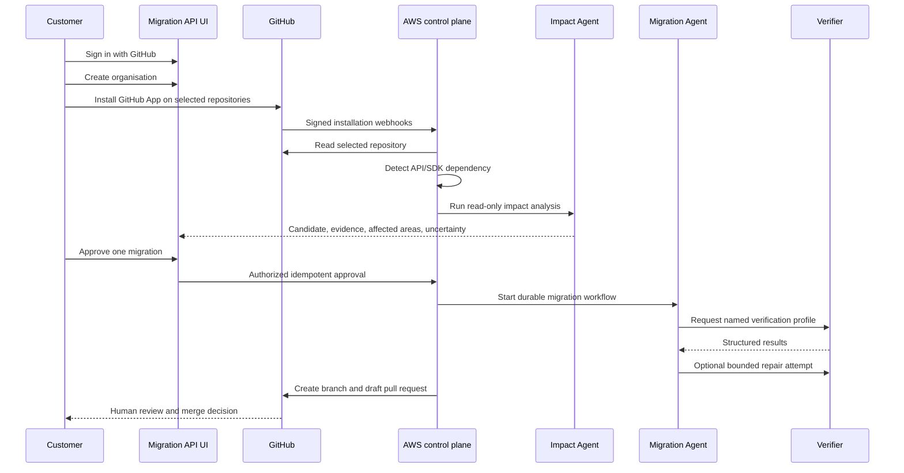
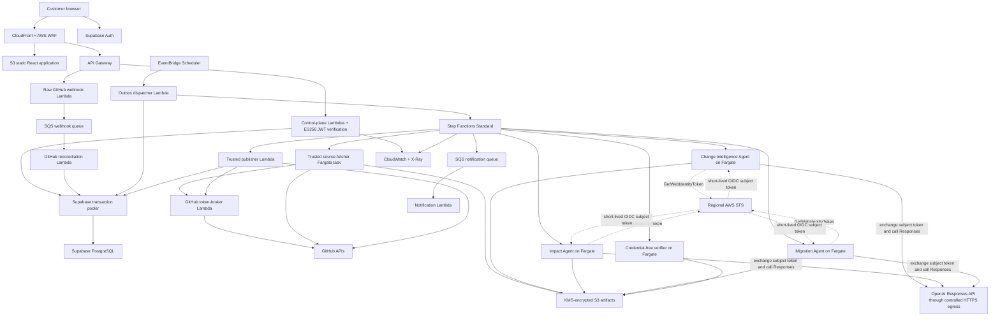
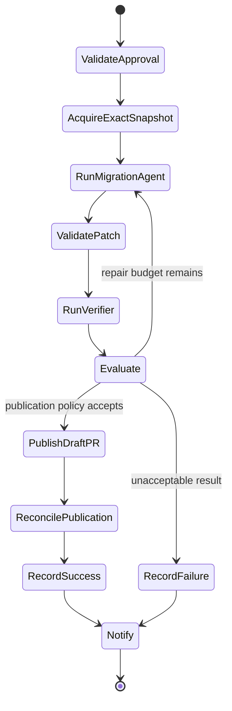

# Migration API

## Greenfield Cloud-First, UI-First, Agentic Product and Implementation Plan

**Status:** Proposed engineering baseline  
**Planning perspective:** Greenfield; no prior prototype, schema, manifest,
package layout, or code decision is authoritative  
**Primary cloud:** AWS  
**Authoritative database:** Supabase PostgreSQL  
**Primary source-control integration:** GitHub App  
**Primary model provider:** OpenAI API  
**Primary implementation language:** TypeScript  
**Last updated:** 2026-07-24

---

## 1. Executive decision

Build Migration API as a cloud product from the first functional milestone, not
as a local migration script that is moved to AWS later.

The first functional milestone must already contain:

- A deployed web UI.
- User authentication.
- A real API.
- Durable PostgreSQL state.
- A real Step Functions workflow.
- A real Fargate-based agent.
- A real OpenAI Responses API invocation.
- Typed agent tools.
- Explicit budgets and terminal states.
- Encrypted artifacts in S3.
- An observable result shown in the UI.

That first agent operates only on controlled synthetic migration evidence. It
does not access customer repositories or write code yet. Subsequent stages
increase its authority gradually:

```text
synthetic evidence
  → read-only GitHub inventory
  → read-only repository impact analysis
  → approved patch generation
  → isolated verification
  → trusted draft pull-request publication
```

This ordering makes the product UI-first and agentic from the beginning while
keeping credentials, mutation, and untrusted code outside the model's authority.

---

## 2. Fixed constraints, assumptions, and uncertainties

### 2.1 Fixed constraints

These are the only inherited product constraints:

1. The product is deployed to AWS from the beginning.
2. The customer begins in a web UI.
3. Repository access is granted through a GitHub App.
4. The UI shows APIs or SDKs that require migration.
5. A human approves before the platform mutates a repository.
6. AWS Lambda, API Gateway, Step Functions, Fargate, and supporting AWS services
   are first-class architectural components.
7. Supabase PostgreSQL stores authoritative application state.
8. Agentic AI is part of the first functional cloud milestone.
9. OpenAI models are the primary models for agent reasoning.
10. The resulting product should support a credible YC application and live
    demonstration.

### 2.2 Assumptions

- Initial customers use GitHub Cloud.
- Initial repositories primarily use TypeScript or JavaScript.
- Initial dependencies are npm packages or directly detectable HTTP API client
  integrations.
- Initial customers will install a GitHub App that requests repository contents
  write permission and pull-request write permission.
- The OpenAI API and the selected OpenAI model are enabled for the project's
  OpenAI account.
- AWS outbound workload identity federation is available for the selected AWS
  account and OpenAI project before production.
- AWS and the Supabase project can be placed in nearby regions.
- A draft pull request is an acceptable delivery mechanism.
- The first design partners accept a limited repository-size and verification
  policy.

### 2.3 Uncertainties that engineering cannot resolve alone

- Whether customers will trust the requested GitHub write permission.
- Whether teams care enough about API migrations to install another GitHub App.
- Whether public vendor documentation contains sufficient migration evidence.
- Whether generated patches are accepted with little enough human editing.
- Whether vendors will eventually publish structured migration data.
- Whether customers want the product to act as a bot or require every mutation
  to be attributed to an individual GitHub user.
- Whether TypeScript/npm is the correct initial ecosystem.

These uncertainties must be tested with users during implementation. A polished
architecture is not evidence of product demand.

---

## 3. Product definition

Migration API identifies upstream API and SDK changes that affect customer
repositories, performs read-only impact analysis, and—after explicit
approval—uses an agent to prepare, verify, and publish a draft migration pull
request.

It is not a runtime API proxy. It does not sit between application traffic and
the API vendor.

### 3.1 Actors

#### Customer owner

- Creates the Migration API organisation.
- Installs the GitHub App.
- Selects repositories.
- Manages members and data policy.

#### Customer reviewer

- Reviews detected migration opportunities.
- Reviews evidence and estimated scope.
- Approves or rejects a migration attempt.
- Reviews the generated pull request.

#### API vendor

- Publishes releases, changelogs, migration guides, API specifications, or SDK
  versions.
- May later publish a structured migration specification directly.

#### Migration API operator

- Registers trusted vendor sources.
- Reviews agent-drafted vendor change specifications during the initial product
  phase.
- Investigates operational failures without broad source access.

#### Agents

- Change Intelligence Agent: turns trusted vendor evidence into a draft
  migration specification.
- Impact Analysis Agent: determines whether and how a repository is affected;
  read-only.
- Migration Agent: proposes and revises a patch after approval.

### 3.2 Consent boundaries

There are two distinct customer authorizations.

#### Installation consent

Installing the GitHub App authorizes:

- Listing selected repositories.
- Reading selected repositories.
- Taking bounded snapshots.
- Detecting dependencies.
- Performing read-only impact analysis.

It does not authorize creating branches or pull requests merely because the App
technically has those permissions.

#### Migration approval

Approving one candidate authorizes:

- Reacquiring an exact repository snapshot.
- Sending the minimum required source context to the configured model.
- Creating a bounded patch in an isolated workspace.
- Running allowed verification commands.
- Creating a migration branch.
- Opening or updating a draft pull request.

Approval never authorizes:

- Automatic merge.
- Production deployment.
- Changing secrets or repository settings.
- Bypassing branch protection.
- Access to other repositories.
- Unbounded agent execution.

The approval record is immutable and includes the scope and policy version shown
to the reviewer.

### 3.3 Initial end-to-end user journey



### 3.4 Initial product scope

- GitHub Cloud only.
- npm ecosystem first.
- TypeScript and JavaScript source first.
- One synthetic vendor and one real vendor/SDK during pilot.
- Default branch analysis.
- Draft pull requests.
- No automatic merge.
- No customer production credentials.

### 3.5 Non-goals for the initial product

- Generic autonomous coding.
- Every programming language.
- GitLab, Bitbucket, or GitHub Enterprise Server.
- Runtime request proxying.
- Automatic deployment.
- Arbitrary shell access for the model.
- Autonomous trust of arbitrary internet sources.
- General web crawling.
- Customer secret discovery or use.
- Automatic changes to CI workflows or infrastructure.
- A vendor marketplace before customer demand is proven.

---

## 4. Architectural principles

1. **The UI is a real product surface from the first milestone.**
2. **A real bounded agent runs in the first milestone.**
3. **Read-only impact analysis precedes mutation approval.**
4. **The model proposes intent; deterministic code enforces policy.**
5. **No model or untrusted test receives GitHub or database credentials.**
6. **Repository acquisition, agent reasoning, verification, and publication use
   separate trust zones.**
7. **PostgreSQL owns business state; Step Functions owns orchestration; S3 owns
   large immutable evidence.**
8. **All cross-system delivery is idempotent and reconcilable.**
9. **Every loop, request, file, patch, command, retry, and artifact is
   bounded.**
10. **Verification evidence is reported honestly; tests are not proof of
    complete safety.**
11. **No automatic merge.**
12. **Every stage deploys and answers a product question, not only an
    engineering question.**
13. **Avoid infrastructure that does not support the next customer-facing
    milestone.**
14. **Use standard PostgreSQL so Supabase is replaceable if necessary.**
15. **Prefer explicit typed agent machinery over a hidden agent framework.**

---

## 5. Target system architecture



### 5.1 Request path

CloudFront serves one product domain:

- Static frontend origin for application assets.
- API Gateway origin for `/api/*`.

Benefits:

- One browser origin and simpler CORS policy.
- AWS WAF can protect the CloudFront distribution.
- Consistent TLS and security headers.
- Independent caching rules for static assets and APIs.

The GitHub webhook route may use a dedicated API Gateway hostname if required to
preserve operational separation, but it still terminates in the raw-body webhook
Lambda.

### 5.2 Control plane

Lambda handles:

- Authentication and authorization.
- Organisation membership.
- GitHub installation linking.
- Repository inventory.
- Candidate and impact-report APIs.
- Approval.
- Cancellation requests.
- Status and artifact links.
- Webhook intake and reconciliation.
- Outbox dispatch.
- Token brokering.
- Pull-request publication.

Lambda does not:

- Clone repositories.
- Run repository commands.
- Run the agent loop.
- Execute tests.

### 5.3 Execution plane

ECS/Fargate handles:

- Repository acquisition.
- Vendor source acquisition where a container is required.
- Agent loops.
- Patch workspaces.
- Verification.

Each workload has its own:

- Container image.
- ECS task definition.
- Task role.
- Security group.
- subnet class.
- CPU/memory/ephemeral-storage limit.
- timeout.
- input and output schema.

### 5.4 State ownership

| State                                         | Owner               |
| --------------------------------------------- | ------------------- |
| Users, organisations, permissions             | Supabase PostgreSQL |
| GitHub installations and repository inventory | Supabase PostgreSQL |
| Candidates, approvals, runs, PR records       | Supabase PostgreSQL |
| Workflow progression and retries              | Step Functions      |
| Repository snapshots, prompts, patches, logs  | S3                  |
| GitHub branch and PR state                    | GitHub              |
| Operational logs and metrics                  | CloudWatch          |

No distributed transaction is assumed. Partial failures are closed through
idempotency and reconciliation.

---

## 6. Technology decisions

### 6.1 Frontend

- React.
- TypeScript strict mode.
- Vite.
- React Router.
- A small server-state/query library only when needed.
- Accessible component primitives.
- Static S3 hosting behind CloudFront.

Why:

- The product is an authenticated dashboard.
- Server-side rendering is unnecessary initially.
- Static deployment reduces operational surface.
- API secrets remain server-side.

### 6.2 Backend

- TypeScript and Node.js.
- API Gateway Lambda proxy integrations.
- AWS SDK v3 service-specific clients.
- A strict schema validator at every external boundary.
- Kysely plus `pg` for PostgreSQL.
- Octokit libraries for GitHub App auth and webhook validation.

### 6.3 Agent runtime

- TypeScript agent kernel.
- Official OpenAI SDK.
- OpenAI Responses API.
- OpenAI `gpt-5.6-sol` as the initial quality-first model.
- Custom function tools with strict schemas.
- Structured Outputs for plans, specifications, and terminal results.
- `store: false` on model requests.
- AWS-to-OpenAI Workload Identity Federation for production authentication.
- No general agent framework initially.
- No model-facing arbitrary shell.
- Versioned JSON schemas for model responses and tools.

The model ID and reasoning configuration remain deployment configuration rather
than business logic. Start evaluation with `gpt-5.6-sol` and medium reasoning,
then compare high and xhigh on representative migration tasks. Do not select the
highest reasoning effort merely because cost is not a concern; latency,
reliability, and quality must be measured.

The application uses Responses rather than Chat Completions because the
Responses API is designed for reasoning and tool-using workflows. OpenAI-hosted
web search, shell, Code Interpreter, file search, Conversations, and remote MCP
are not enabled initially. Repository tools continue to run inside our
policy-controlled Fargate agent.

### 6.4 Why OpenAI

OpenAI is selected for the reasoning layer because this product depends on
strong code understanding, tool selection, structured output, and multi-step
repair. The current quality-first starting point is `gpt-5.6-sol`, but the model
must pass repository-specific evaluations before production.

OpenAI does not replace the AWS agent runtime:

- Step Functions still orchestrates.
- Fargate still owns the agent loop and workspace.
- Our function tools still enforce policy.
- S3 and PostgreSQL still own state and evidence.
- The verifier still executes tests independently.

The tradeoff is real: OpenAI is outside the AWS VPC. Agent tasks need controlled
HTTPS egress, and selected customer source is transmitted to OpenAI. The product
must disclose this, minimize context, set `store: false`, and verify the OpenAI
project's data controls before onboarding customer repositories.

The model gateway remains an internal interface so a provider outage, regional
requirement, or measured quality regression can be handled without rewriting the
agent domain. It is not intended to create a multi-provider abstraction before
there is a real second provider.

### 6.5 Infrastructure

- Terraform with pinned providers.
- Separate modules for network, edge, API, data access, workflows, compute,
  observability, and CI roles.
- GitHub Actions OIDC for deployment.
- ECR for container images.

### 6.6 Why not use Lambda for agents

Lambda is appropriate for short control-plane operations, but migration agents
need:

- Longer execution.
- A disposable filesystem.
- Configurable compute and storage.
- Containerized parsers and tools.
- Isolation from API concurrency.

Lambda's maximum execution duration is not a suitable foundation for repository
migrations.

### 6.7 Why not use DynamoDB for application state

The domain is relational and transaction-heavy:

- Organisation membership and authorization.
- Installations and selected repositories.
- Dependency observations and releases.
- Candidates and immutable approvals.
- Runs, attempts, artifacts, and pull requests.
- Operational and product queries.

Supabase PostgreSQL is the authoritative application database. DynamoDB is not
introduced merely because the system runs on AWS.

### 6.8 Why not use a vector database initially

Initial retrieval can be deterministic:

- Package and version identity.
- Release evidence.
- Import and symbol search.
- AST/type information.
- Lexical source search.

A vector index adds ingestion, security, deletion, evaluation, and tenant
isolation work. Add `pgvector` only if measured retrieval failures show that
semantic search materially improves migrations.

---

## 7. Greenfield repository structure

```text
apps/
  web/
services/
  api/
  webhook-ingress/
  github-reconciler/
  outbox-dispatcher/
  token-broker/
  publisher/
  notifier/
workers/
  source-fetcher/
  vendor-fetcher/
  agent/
  verifier/
packages/
  contracts/
  config/
  domain/
  database/
  authorization/
  github/
  agent-kernel/
  agent-tools/
  model-gateway/
  migration-spec/
  observability/
  test-fixtures/
infra/
  terraform/
    bootstrap/
    modules/
    environments/
supabase/
  migrations/
  seed/
docs/
  adr/
  architecture/
  runbooks/
  security/
```

### 7.1 Dependency direction

```text
apps/services/workers
        ↓
application packages
        ↓
domain + contracts
```

Rules:

- Domain packages do not import AWS, GitHub, Supabase, or web frameworks.
- AWS and GitHub implementations sit behind interfaces.
- External payloads remain `unknown` until validated.
- Agent tools depend on policy interfaces, not infrastructure credentials.
- Cyclic package dependencies fail CI.
- Shared packages exist only when at least two real consumers require them.

### 7.2 Runtime standards

- Strict TypeScript.
- No unchecked `any`.
- ECMAScript modules.
- Explicit nullability.
- Startup configuration validation.
- Structured errors with safe public codes.
- Small cohesive functions.
- Dependency versions locked.
- Node.js LTS version selected and pinned when implementation begins.

---

## 8. Authentication and authorization

### 8.1 Authentication decision

Use Supabase Auth with GitHub social login for application identity.

Use a separate GitHub App for repository access and bot automation.

This means two GitHub concepts exist:

- GitHub OAuth through Supabase: “Who is this dashboard user?”
- GitHub App installation: “Which repositories may the platform access?”

This is deliberate. Building a custom session and token-refresh system around
GitHub App user tokens would create avoidable authentication risk for the
initial product.

### 8.2 Login flow

1. Browser starts GitHub social login through Supabase Auth using PKCE.
2. GitHub authenticates the user.
3. Supabase returns a session.
4. Browser sends the access token to the API.
5. Authorizer validates:
   - Signature using Supabase JWKS.
   - Issuer.
   - Audience.
   - Expiration.
   - Not-before where present.
   - Subject.
6. API loads current application membership from PostgreSQL.

Never use user-editable JWT metadata as the authoritative organisation role.

### 8.3 Organisation roles

| Action                           | Owner | Admin | Reviewer | Viewer |
| -------------------------------- | ----: | ----: | -------: | -----: |
| View repositories and candidates |   Yes |   Yes |      Yes |    Yes |
| Trigger read-only scan           |   Yes |   Yes |      Yes |     No |
| Approve migration                |   Yes |   Yes |      Yes |     No |
| Cancel migration                 |   Yes |   Yes |      Yes |     No |
| Revoke migration approval        |   Yes |   Yes |      Yes |     No |
| Manage GitHub installation       |   Yes |   Yes |       No |     No |
| Manage members                   |   Yes |    No |       No |     No |
| Change retention policy          |   Yes |    No |       No |     No |

### 8.4 Authorization implementation

Every sensitive handler calls:

```text
authorize(actor, action, organisationId, resource)
```

The implementation:

- Loads current membership.
- Loads the resource using both resource ID and organisation ID.
- Checks resource state.
- Checks installation state where relevant.
- Produces an audit event for mutation.

A valid UUID is never authorization.

### 8.5 Bot attribution tradeoff

The initial publisher uses a GitHub App installation token, so commits and pull
requests are attributed to the App bot. The immutable approval record identifies
the human reviewer inside Migration API.

GitHub recommends user access tokens for actions that must be constrained by
both App and individual user permissions. If design partners require GitHub-side
human attribution, add a user-to-server authorization mode with expiring tokens.
Do not implement refresh-token storage until that requirement is proven.

---

## 9. GitHub App

### 9.1 Initial repository permissions

- Metadata: read.
- Contents: read and write.
- Pull requests: read and write.

Events:

- `installation`
- `installation_repositories`
- `repository`
- `push`
- `pull_request`

Explicitly not requested:

- Administration.
- Actions.
- Workflows.
- Secrets.
- Deployments.
- Environments.
- Organisation members.

### 9.2 Permission risk

Contents write permission is technically necessary to create a branch in a
private customer repository. It is also likely the largest onboarding objection.

Mitigations:

- Selected repositories only.
- No organisation-wide permissions.
- Clear approval semantics.
- No automatic merge.
- Short-lived tokens.
- Customer branch protection.
- Complete audit trail.
- Public documentation of requested permissions.

Do not hide this tradeoff behind reassuring language.

### 9.3 Installation linking

1. Owner/admin requests an installation URL.
2. API creates at least 256 bits of random state.
3. API stores only a digest, user ID, organisation ID, expiry, and allowlisted
   return path.
4. Browser redirects to GitHub.
5. GitHub redirects to the setup callback.
6. API atomically validates and consumes state.
7. API verifies the installation using GitHub App authentication.
8. API confirms the caller may link it to the organisation.
9. API upserts installation metadata.
10. Reconciliation obtains the selected repository set.
11. Scans are queued.

Callback query parameters are untrusted until verified against GitHub.

### 9.4 Webhook ingestion

Webhook Lambda:

1. Reads the unmodified raw body.
2. Enforces a strict byte limit.
3. Requires delivery ID, event name, and `X-Hub-Signature-256`.
4. Calculates HMAC-SHA256.
5. Compares using a timing-safe operation.
6. Rejects invalid signatures before parsing.
7. Stores/enqueues a bounded event envelope.
8. Returns quickly.

Reconciliation worker:

- Deduplicates using GitHub delivery ID.
- Treats delivery order as unreliable.
- Fetches current GitHub state where needed.
- Uses bounded retries.
- Sends poison events to a DLQ.

### 9.5 Token broker

Only the token-broker Lambda can read the GitHub App private key.

Callers invoke the broker using AWS IAM identity and provide:

- Run ID.
- Repository ID.
- Intended operation.

The broker:

1. Verifies the run and repository binding.
2. Verifies installation state.
3. Verifies caller role is allowed for the operation.
4. Requests the narrowest installation token.
5. Returns the token only to the trusted caller.
6. Logs metadata, never the token.

The token never appears in:

- Step Functions input.
- ECS task definition or overrides.
- PostgreSQL.
- S3.
- CloudWatch.
- Browser responses.

Installation tokens are short-lived and are not cached beyond the operation.

### 9.6 Lifecycle behaviour

- Installation removed: block scans and publication immediately.
- Installation suspended: pause new work.
- Repository removed: revoke local availability.
- Repository archived: keep history, block new migrations by policy.
- Repository renamed/transferred: reconcile IDs; GitHub numeric ID remains
  authoritative.
- Pull request merged/closed: update local delivery outcome idempotently.

---

## 10. Supabase PostgreSQL

### 10.1 Connection topology

Lambda runtime traffic uses the Supabase transaction pooler:

- TLS required.
- Certificate verification enabled.
- Named prepared statements disabled.
- Maximum one small client connection per warm Lambda environment initially.
- Short statement, lock, and transaction timeouts.
- Lambda reserved concurrency limits connection storms.

Schema migration and backup operations use a direct connection or session-mode
connection as supported by the selected network.

### 10.2 Network restrictions

Place database-using Lambdas in private AWS subnets with egress through fixed
NAT Elastic IPs.

Allowlist those IPs in Supabase database network restrictions.

Notes:

- Restrictions apply to PostgreSQL and its pooler.
- Supabase Auth remains an HTTPS service and follows its own exposure model.
- Agent and verifier subnets do not receive a route to Supabase.
- Select nearby AWS and Supabase regions to reduce latency.

### 10.3 Database migration execution

Do not temporarily open Supabase to dynamic GitHub-hosted runner IP ranges.

Deployment pipeline:

1. CI authenticates to AWS with OIDC.
2. CI starts a one-off migration task in the control VPC.
3. Task receives the dedicated migration credential from Secrets Manager.
4. Task connects through the approved Supabase route.
5. Task applies repository-owned SQL migrations.
6. Task writes a migration result and exits.

The application runtime role cannot alter schema.

### 10.4 Database roles

- `app_owner`: owns schema; never used by runtime.
- `app_migrator`: applies reviewed migrations.
- `app_runtime`: limited CRUD for backend services.
- `app_readonly`: operational queries where approved.

Avoid broad Supabase service-role use. The backend connects directly to
PostgreSQL with a least-privilege role.

### 10.5 Portability rules

- Standard PostgreSQL types and SQL.
- Repository-owned migrations.
- Kysely plus `pg`.
- No critical workflow logic in Supabase Edge Functions.
- No critical event delivery through Supabase database webhooks.
- No direct browser writes to core business tables.
- Supabase-specific features require an ADR.

These constraints preserve a reasonable path to RDS or Aurora PostgreSQL.

---

## 11. Data model

All mutable tables include:

- `created_at timestamptz`.
- `updated_at timestamptz`.
- Optimistic version where concurrent mutation matters.

Internal IDs are UUIDs. GitHub IDs use `bigint`. Source artifacts are referenced
by S3 key and digest, not stored in PostgreSQL.

### 11.1 Identity and tenancy

`app_users`

- Supabase Auth user ID.
- Display name and avatar metadata.
- Lifecycle state.

`organisations`

- ID, slug, name.
- Status.
- Retention-policy version.

`organisation_memberships`

- Organisation ID.
- User ID.
- Role.
- Unique organisation/user.

### 11.2 GitHub

`github_installations`

- Organisation.
- GitHub installation ID.
- GitHub account ID, login, and type.
- Status and suspension/revocation timestamps.
- Last reconciliation time.
- Unique GitHub installation ID.

`repositories`

- Organisation and installation.
- GitHub repository ID.
- Owner, name, full name.
- Default branch.
- Visibility classification.
- Selected, archived, and enabled flags.
- Unique GitHub repository ID.

`github_webhook_deliveries`

- Delivery ID primary key.
- Event and action.
- Payload digest.
- Processing state and attempts.
- Safe error.
- Received/processed timestamps.

`installation_link_states`

- State digest primary key.
- User and organisation.
- Expiry.
- Consumed timestamp.
- Allowlisted return target.

### 11.3 Vendor intelligence

`vendors`

- Slug, name, official domains.
- Trust state.

`api_products`

- Vendor.
- Ecosystem.
- Canonical package or API identifier.
- Source configuration.
- Unique ecosystem/identifier.

`vendor_sources`

- API product.
- Source kind.
- Canonical URL or registry identity.
- Trust state.
- Check schedule.

`vendor_releases`

- API product and version.
- Published time.
- Evidence bundle artifact.
- Source digest.
- Processing/trust state.
- Unique product/version/revision.

`migration_specifications`

- Source and target compatibility.
- Schema version.
- Structured change data.
- Evidence artifact and digest.
- Draft/reviewed/vendor-verified state.
- Immutable revision.

### 11.4 Repository inventory

`repository_snapshots`

- Repository.
- Commit SHA.
- Acquisition purpose.
- Status.
- Artifact.
- Digest, bytes, file count.
- Expiry.
- Unique repository/commit/purpose.

`dependency_observations`

- Snapshot.
- API product.
- Manifest/lockfile path.
- Declared range.
- Resolved version when reliable.
- Discovery method.
- Evidence and confidence category.

`repository_scans`

- Repository and requested commit.
- Status and attempt.
- Trigger source.
- Started/completed timestamps.
- Safe failure.

### 11.5 Candidates and impact

`migration_candidates`

- Organisation.
- Repository.
- Migration specification.
- Dependency observation.
- Status: `open`, `dismissed`, `superseded`, `resolved`.
- First/last detected.
- Unique active repository/specification pair.

`impact_reports`

- Candidate.
- Repository snapshot.
- Impact-agent run.
- Affected files/symbols summary.
- Risk category.
- Verification availability.
- Uncertainty.
- Artifact.
- Immutable revision.

### 11.6 Approval and execution

`migration_approvals`

- Candidate and impact-report revision.
- Approving user.
- Approval-scope version.
- Approved repository/base state.
- Approved policy versions.
- Timestamp.
- Revoked timestamp if revoked before work begins.
- Append-only.

`migration_runs`

- Candidate and approval.
- Exact base commit.
- Status and current stage.
- Attempt.
- Workflow execution ARN.
- Terminal result.
- Safe failure code.
- Optimistic version.

`agent_runs`

- Agent type.
- Migration or release context.
- Policy version.
- Tool-registry version.
- OpenAI project, requested model, returned model, API mode, and reasoning
  configuration.
- Status and terminal reason.
- Iterations, tokens, duration.

`agent_actions`

- Agent run.
- Sequence.
- Tool name/version.
- Validated input digest.
- Outcome.
- Evidence artifact.
- Duration.
- Unique run/sequence.

`patch_attempts`

- Migration run.
- Attempt number.
- Parent attempt.
- Patch artifact and digest.
- Policy validation result.
- Summary.

`verification_runs`

- Migration run and patch attempt.
- Profile and policy version.
- Status.
- Commands executed as structured identifiers.
- Result artifact.
- Duration.

`pull_requests`

- Migration run and repository.
- GitHub PR number/node ID.
- Branch.
- Base/head SHA.
- URL.
- Draft and lifecycle state.
- Unique repository/branch and repository/PR number.

### 11.7 Artifacts, delivery, and audit

`artifacts`

- Organisation.
- Owning resource.
- Artifact type.
- S3 key.
- SHA-256 digest.
- Media type and bytes.
- Retention class.

`workflow_outbox`

- Event ID.
- Event type.
- Aggregate type/ID.
- Unique idempotency key.
- Bounded payload.
- Available time.
- Lease owner/expiry.
- Attempts.
- Delivered timestamp.
- Safe error.

`notifications`

- Event, recipient, channel.
- Unique idempotency key.
- State, attempts, provider reference.

`audit_events`

- Organisation.
- Actor type/ID.
- Action.
- Resource type/ID.
- Request/correlation ID.
- Redacted metadata.
- Timestamp.
- Append-only.

### 11.8 State machines

Candidate:

```text
open → dismissed
open → superseded
open → resolved
```

Migration run:

```text
queued
  → acquiring
  → planning
  → patching
  → verifying
  → repairing
  → publishing
  → pr_opened

Any active state → failed | cancelled | stale
```

Do not overload one status column with candidate, agent, verification, and PR
state. Each aggregate owns its state.

### 11.9 Row-level security

- Enable RLS on any table reachable through Supabase APIs.
- Anonymous access denied.
- Core business tables have no direct browser mutation policy.
- Browser uses API Gateway for product data.
- User profile access is narrowly scoped.
- Service keys never appear in frontend assets.

RLS is defence in depth. Server-side authorization remains mandatory.

---

## 12. API contracts

### 12.1 General contract

- JSON request/response.
- `/v1` version prefix.
- Strict request validation.
- Unknown fields rejected for mutations.
- Opaque cursor pagination.
- Maximum page and body sizes.
- Stable machine-readable error codes.
- Request ID returned to client.
- No stack traces or upstream bodies.

Error:

```json
{
  "error": {
    "code": "MIGRATION_NOT_APPROVABLE",
    "message": "The migration cannot be approved in its current state.",
    "requestId": "01..."
  }
}
```

### 12.2 Identity and organisation

- `GET /v1/me`
- `GET /v1/organisations`
- `POST /v1/organisations`
- `GET /v1/organisations/{organisationId}`
- `GET /v1/organisations/{organisationId}/members`
- `POST /v1/organisations/{organisationId}/members`
- `PATCH /v1/organisations/{organisationId}/members/{userId}`

### 12.3 GitHub

- `POST /v1/organisations/{organisationId}/github/install-link`
- `GET /v1/github/setup/callback`
- `POST /v1/github/webhooks`
- `GET /v1/organisations/{organisationId}/github/installations`
- `GET /v1/organisations/{organisationId}/repositories`
- `POST /v1/organisations/{organisationId}/repositories/{repositoryId}/reconcile`

### 12.4 Discovery

- `POST /v1/organisations/{organisationId}/repositories/{repositoryId}/scans`
- `GET /v1/organisations/{organisationId}/repositories/{repositoryId}/dependencies`
- `GET /v1/organisations/{organisationId}/candidates`
- `GET /v1/organisations/{organisationId}/candidates/{candidateId}`
- `POST /v1/organisations/{organisationId}/candidates/{candidateId}/dismiss`

### 12.5 Migration

- `POST /v1/organisations/{organisationId}/candidates/{candidateId}/approvals`
- `GET /v1/organisations/{organisationId}/runs`
- `GET /v1/organisations/{organisationId}/runs/{runId}`
- `POST /v1/organisations/{organisationId}/runs/{runId}/cancel`
- `GET /v1/organisations/{organisationId}/runs/{runId}/artifacts`

### 12.6 Approval request

Requires:

- Candidate ID from path.
- Impact-report revision/ETag.
- Approval-scope version.
- Explicit acknowledgement of branch/draft-PR creation.
- `Idempotency-Key` header.

Server derives:

- Organisation.
- Repository.
- Migration specification.
- Actor.
- Current policy.

The client cannot nominate a different repository or GitHub installation in the
body.

### 12.7 Status updates

Start with authenticated polling:

- ETag or monotonic version.
- Back off while unchanged.
- Refresh immediately after mutation.
- Stop at terminal state.

Do not expose core tables directly through Supabase Realtime in the first
version. Reconsider Server-Sent Events when workflow semantics are stable.

---

## 13. Event contracts and idempotency

Every internal event contains:

- Schema version.
- Event ID.
- Event type.
- Occurred time.
- Correlation ID.
- Organisation ID when applicable.
- Aggregate ID and version.
- Idempotency key.
- Bounded payload containing identifiers, not source or secrets.

### 13.1 Webhook idempotency

Unique GitHub delivery ID.

Duplicate delivery:

- Return/acknowledge success after confirming it was accepted.
- Do not duplicate downstream operations.

### 13.2 API idempotency

Mutation endpoint stores:

- Actor.
- Route/action.
- Idempotency key.
- Request digest.
- Result resource.

Same key and same digest returns the previous result.

Same key and different digest is a conflict.

### 13.3 Workflow idempotency

- Execution name derived from migration run ID.
- Task attempt IDs included in artifact keys.
- Result ingestion checks expected state and attempt.
- Branch name derived from run ID.
- Publisher searches for an existing PR before creating.
- Notification key includes event, recipient, and channel.

### 13.4 Transactional outbox

Approval transaction:

1. Lock candidate.
2. Revalidate current membership and role.
3. Revalidate installation and repository selection.
4. Revalidate impact-report revision.
5. Insert immutable approval.
6. Insert migration run.
7. Insert `START_MIGRATION` outbox event.
8. Commit.

Dispatcher:

1. Claim rows with `FOR UPDATE SKIP LOCKED`.
2. Set a recoverable lease.
3. Start Step Functions using deterministic execution name.
4. Treat an already-existing matching execution as delivered.
5. Mark delivered.
6. Retry transient failures with exponential backoff and jitter.
7. Alarm on oldest event age and terminal delivery failure.

---

## 14. Agent platform

### 14.1 Shared agent kernel

All agents use one kernel:

```text
load checkpoint
  → assemble bounded context
  → ask model for structured next action
  → validate response
  → authorize tool
  → execute tool
  → persist action/evidence
  → update budget
  → continue or terminate
```

The kernel owns:

- Policy version.
- Tool registry.
- Checkpoint state.
- Model adapter.
- Schema validation.
- Budget enforcement.
- Redaction.
- Terminal classification.

Step Functions owns the outer business workflow. The agent kernel owns only the
bounded reasoning loop inside one Fargate task.

### 14.2 Agent types

#### Change Intelligence Agent

Input:

- Trusted vendor evidence bundle.
- Previous release/specification.
- Product identity.

Output:

- Draft structured migration specification.
- Evidence mapping.
- Ambiguities and confidence category.

It cannot mark its output trusted. Promotion requires policy and initially a
human operator.

#### Impact Analysis Agent

Input:

- Read-only repository snapshot.
- Reviewed migration specification.

Output:

- Whether the repository appears affected.
- Potential files and symbols.
- Expected change types.
- Verification availability.
- Risk and uncertainty.

It cannot mutate source.

#### Migration Agent

Input:

- Exact approved repository snapshot.
- Reviewed migration specification.
- Approved impact-report revision.
- Allowed patch and verification policy.

Output:

- Structured plan.
- Patch attempts.
- Verification requests.
- Final evidence and uncertainty.

It cannot publish to GitHub.

### 14.3 Model gateway

Interface:

```text
runAgentTurn(
  modelConfiguration,
  systemPolicy,
  inputItems,
  allowedFunctionTools,
  terminalOutputSchema,
  budget
)
```

Responsibilities:

- Map the internal request to the OpenAI Responses API.
- Enforce configured model allowlist.
- Authenticate through AWS-to-OpenAI workload identity federation.
- Expose only the function tools allowed for the current agent phase.
- Require strict JSON schemas for tool arguments and terminal output.
- Set `store: false`.
- Keep background mode disabled.
- Keep OpenAI-hosted tools disabled.
- Disable silent context truncation; context overflow is an explicit failure.
- Set timeouts and output limits.
- Record requested/returned model, reasoning configuration, usage, latency, and
  OpenAI request ID.
- Redact provider errors.
- Classify authentication, validation, rate-limit, timeout, safeguard, and
  provider failures.
- Support deterministic test doubles.

Do not scatter OpenAI calls through tools or business services.

#### Initial model configuration

- Model: `gpt-5.6-sol`.
- API: Responses.
- Reasoning effort: medium baseline.
- Compare medium, high, and xhigh on the migration evaluation set.
- Parallel function calls: disabled initially for deterministic sequencing.
- Background mode: disabled.
- Response storage: disabled with `store: false`.
- Built-in web search, shell, Code Interpreter, file search, remote MCP, and
  Conversations: disabled.
- Context truncation: disabled.
- Stable privacy-preserving `safety_identifier`: derived from an internal user
  identifier, never an email address or GitHub login.

Model aliases and capabilities can change. Record the configured model and the
model returned by the API. Pin an eligible snapshot for production if OpenAI
exposes one and evaluations show that reproducibility is better than following
the moving alias.

#### Stateless continuation

Migration API owns agent state. It does not use OpenAI Conversations as the
authoritative record.

For each tool turn:

1. Send the bounded system policy and current input items.
2. Receive a structured function call or terminal result.
3. Validate and execute the function locally.
4. Append the function output to the bounded in-memory turn state.
5. Continue with `store: false`.

If preserving model reasoning across stateless turns materially improves
quality, evaluate replaying encrypted reasoning items supported by the Responses
API. Do not persist readable hidden chain-of-thought. A crashed task resumes
from our structured checkpoint and may lose opaque model reasoning state.

#### Authentication

Production uses OpenAI Workload Identity Federation for AWS:

1. The agent task role calls regional AWS STS `GetWebIdentityToken`.
2. IAM restricts the audience to `https://api.openai.com/v1`.
3. IAM restricts token lifetime, initially to at most 300 seconds.
4. OpenAI validates the AWS-issued OIDC token.
5. The OpenAI SDK exchanges it for a short-lived OpenAI access token.
6. The OpenAI project mapping matches the exact agent IAM role ARN.
7. The mapping grants only the required permission, initially
   `api.model.request`.

Use separate OpenAI projects for development, staging, and production. Use
separate IAM roles and OpenAI service-account mappings for Change Intelligence,
Impact, and Migration agents when this improves auditability and blast-radius
control.

No long-lived OpenAI API key is present in the production agent. If workload
identity federation is unavailable during early development, a project-scoped
API key may be stored temporarily in Secrets Manager with a documented removal
gate before production.

#### Retry and timeout policy

- Retry timeouts, rate limits, and transient provider failures with bounded
  exponential backoff and jitter.
- Respect provider retry/rate-limit headers.
- Do not retry invalid requests, policy refusals, or authentication/permission
  failures without a configuration change.
- Generate an idempotent internal model-call ID for observability, but assume a
  timed-out model request may have been processed.
- Never repeat a side-effecting local tool merely because a model request was
  retried.

### 14.4 Initial tools

Vendor tools:

- `read_vendor_evidence`
- `compare_release_metadata`
- `extract_openapi_diff`
- `draft_migration_specification`
- `finish_change_analysis`

Repository read tools:

- `list_tree`
- `read_text_file`
- `search_text`
- `read_package_manifest`
- `read_lockfile`
- `find_imports`
- `parse_typescript`
- `find_symbol_references`
- `read_migration_specification`
- `read_verification_summary`

Migration action tools:

- `create_migration_plan`
- `propose_patch`
- `validate_patch`
- `apply_patch_to_workspace`
- `request_verification_profile`
- `finish_migration`

There is no model-facing:

- General shell.
- General HTTP.
- SQL.
- GitHub client.
- AWS SDK.
- Secret lookup.
- Absolute filesystem access.

### 14.5 Tool contract

Every tool has:

- Name and semantic version.
- JSON input schema.
- JSON output schema.
- Agent types allowed to invoke it.
- Maximum input/output bytes.
- Timeout.
- Retry classification.
- Side-effect classification.
- Required run state.
- Audit/evidence behaviour.

Tool authorization happens after schema validation and before execution.

### 14.6 Context assembly

Do not send entire repositories to the model.

Context selection:

1. Dependency manifests and lockfile metadata.
2. Files importing the target package.
3. Symbols related to migration changes.
4. Compiler/type evidence.
5. Bounded neighbouring code.
6. Bounded verification excerpts.

Every supplied excerpt records:

- Repository-relative path.
- Commit and artifact digest.
- Byte/line range.
- Retrieval reason.

### 14.7 Prompt injection controls

Repository comments, docs, strings, vendor pages, and logs are untrusted data.

Controls:

- Policy labels them as data, not instructions.
- Tools enforce permissions independently.
- Agent has no GitHub/database secret.
- Agent has no general internet.
- URLs inside source are not fetched.
- Model output is schema validated.
- Patch scope is validated deterministically.
- Budgets are external to the model.
- Model cannot alter policy/tool versions.
- Tests run in a separate credential-free task.

Prompt language is not a security boundary.

### 14.8 Patch policy

Default denied:

- `.git/**`
- `.github/workflows/**`
- Secret/config credential files.
- Infrastructure directories.
- CODEOWNERS and repository governance.
- Binary files.
- Generated/vendor directories.
- Paths outside root.
- Symlink targets.
- Excessive deletes.
- Unsupported lockfile rewriting.

Default limits:

- Changed files.
- Changed lines.
- Patch bytes.
- Individual file bytes.
- Repair attempts.

Policy may be expanded later per ecosystem, but the model cannot expand it.

### 14.9 Budgets

Per run:

- Maximum repository bytes/files.
- Maximum context tokens.
- Maximum output tokens.
- Maximum model calls.
- Maximum tool calls.
- Maximum iterations.
- Maximum patch attempts.
- Maximum verification attempts.
- Maximum changed files/lines.
- Maximum agent wall-clock time.
- Maximum artifact/log bytes.

Budget exhaustion yields a clear terminal state such as
`budget_exhausted_model_calls`, not an unclassified failure.

### 14.10 Agent persistence

Persist:

- Model and configuration ID.
- Policy/tool versions.
- Structured plan.
- Tool calls and outcomes.
- Evidence references.
- Patch digests.
- Verification summaries.
- Usage and duration.
- Concise explanation and uncertainty.

Do not persist:

- Hidden chain-of-thought.
- Credentials.
- Full environment.
- Unbounded prompts duplicating source.

---

## 15. Vendor change intelligence

### 15.1 Trusted source catalogue

Do not let an agent autonomously decide that an arbitrary URL is authoritative.

Each vendor source records:

- Vendor/product.
- Source kind.
- Canonical domain.
- URL/registry identifier.
- Expected content type.
- Trust status.
- Poll cadence.
- Last digest/ETag.

Initial source kinds:

- Package registry release metadata.
- Vendor migration guide.
- Vendor changelog.
- OpenAPI document.
- SDK repository release.

### 15.2 Ingestion workflow

```text
schedule
  → fetch registered source
  → validate origin/content/size
  → store immutable evidence
  → compare with prior release
  → run Change Intelligence Agent
  → validate draft specification
  → human review/promote
  → evaluate customer candidates
```

### 15.3 SSRF protection

Vendor fetcher:

- HTTPS only.
- No embedded URL credentials.
- DNS resolve and reject private, loopback, link-local, multicast, and metadata
  addresses.
- Revalidate redirects.
- Limit redirect count.
- Domain allowlist where possible.
- Timeout and response-byte limit.
- Allowed content types.
- No internal service route.
- No credential forwarding across origins.

### 15.4 Migration specification

The specification is designed greenfield and versioned.

It contains:

- Vendor/product identity.
- Source and target compatibility.
- Evidence references and digests.
- Structured breaking/deprecation/behaviour changes.
- Known symbol and request/response transformations.
- Preconditions.
- Verification recommendations.
- Unsupported/ambiguous cases.
- Trust and review status.

Vendor content may suggest transformations but never provide executable shell
commands.

### 15.5 Synthetic vendor

The first demo uses a controlled vendor with:

- v1 and v2 SDK/API definitions.
- Release notes.
- Migration guide.
- At least one mechanical change.
- At least one change requiring reasoning.
- One deliberately ambiguous change.

It need not be published to a public package registry. The product must prove
its workflow, not npm publishing.

---

## 16. Repository acquisition and scanning

### 16.1 Source fetcher

Trusted Fargate workload:

1. Receives run/repository identifiers only.
2. Calls token broker using task IAM identity.
3. Receives one short-lived scoped token in memory.
4. Resolves exact default-branch commit.
5. Downloads source without executing it.
6. Enforces compressed and expanded limits.
7. Rejects dangerous paths/symlinks.
8. Creates normalized archive.
9. Calculates digest, bytes, and file count.
10. Uploads to run-specific S3 prefix.
11. Emits bounded result envelope.
12. Discards token.

### 16.2 Initial unsupported conditions

- Required Git submodules.
- Required Git LFS content.
- Repository beyond limits.
- Unsupported archive structure.
- Missing supported manifest.
- Repository becomes unavailable during acquisition.

Return explicit unsupported outcomes. Do not loosen security controls to make
the demo pass.

### 16.3 Dependency detection

Initial npm detection:

- `package.json`.
- Supported lockfiles.
- Workspaces/monorepo package roots within limits.
- Dependency, development, optional, and peer declarations.
- Exact resolved version only when lockfile semantics support it.

Store declared range and resolved version separately. Do not pretend a range is
an installed version.

### 16.4 Base-commit race

- Scan records discovery commit.
- Impact report records snapshot commit.
- Approval references impact-report revision.
- Migration reacquires or confirms exact base.
- Publisher rechecks base before push.

If base changed:

- Mark stale, or
- Start an explicit new impact/migration attempt.

Never silently apply an old plan to a new tree.

---

## 17. Verification sandbox

Customer tests are arbitrary code and may be malicious.

### 17.1 Isolation

- Dedicated Fargate task definition.
- Non-root.
- Read-only container root.
- Disposable writable workspace.
- No privileged mode.
- No Docker socket.
- No host mounts.
- Linux capabilities dropped.
- CPU, memory, PID, disk, and wall-clock bounds.
- No reusable task role credentials available to the test process.
- No general internet.

### 17.2 Artifact transfer

Use narrowly scoped, short-lived S3 capabilities:

- Exact input object GET.
- Exact result object PUT.
- Short expiry.
- Download before executing tests.
- Remove capability values from child-process environment.
- Upload after command completion.

The test may tamper with its own output; therefore:

- Output is treated as untrusted.
- Result schema, size, and digest are validated.
- The trusted workflow classifies it.

### 17.3 Verification profiles

Examples:

- `typescript_static`
- `typescript_unit`
- `typescript_full`

Profile resolves to deterministic executable/argument arrays.

The model requests a profile name. It never submits a shell string.

### 17.4 Dependency installation

- Require supported lockfile.
- Pin package-manager version.
- Prefer immutable install such as `npm ci`.
- Ignore lifecycle scripts initially.
- Use controlled package registry path when possible.
- No customer private-registry credentials initially.
- Record lockfile digest and installation policy.

Legitimate projects may require scripts, native builds, or private packages.
Return `partial` or `unavailable` until a secure explicit policy exists.

### 17.5 Process execution

- Use direct process spawn with argument arrays.
- Fixed working directory.
- Minimal allowlisted environment.
- Clear cloud, proxy, model, database, and GitHub variables.
- Kill process tree at timeout.
- Limit stdout/stderr bytes.
- Preserve exit code, signal, and truncation.

### 17.6 Result states

- `passed`
- `failed`
- `partial`
- `unavailable`
- `timed_out`
- `policy_rejected`
- `infrastructure_failed`

Only `passed` means every required check in the selected profile passed.

---

## 18. Workflows

Use Step Functions Standard Workflows and optimized ECS/Fargate integration.

### 18.1 First-milestone demo-agent workflow

```text
ValidateDemoRequest
  → WriteAgentRun
  → RunAgentFargate.sync
  → ValidateResult
  → RecordTerminalState
```

This exists in the first functional milestone.

### 18.2 Repository scan workflow

```text
ValidateInstallation
  → AcquireSnapshot
  → DetectDependencies
  → PersistObservations
  → EvaluateKnownReleases
  → QueueImpactAnalysis
```

### 18.3 Vendor intelligence workflow

```text
FetchRegisteredSources
  → ValidateEvidence
  → DetectReleaseChange
  → RunChangeIntelligenceAgent
  → ValidateDraftSpecification
  → Await/RecordReview
  → EvaluateCandidates
```

### 18.4 Impact analysis workflow

```text
ValidateCandidate
  → EnsureSnapshot
  → BuildReadOnlyContext
  → RunImpactAgent
  → ValidateImpactReport
  → PersistReport
  → NotifyReviewer
```

### 18.5 Approved migration workflow



### 18.6 Workflow input

Only:

- Organisation ID.
- Run/candidate/approval IDs.
- Repository ID.
- Expected attempt/version.
- Correlation ID.

Never:

- Source.
- GitHub token.
- Database password.
- Model credential.
- Raw prompt.
- Raw log.

### 18.7 Retry policy

Retry:

- AWS throttling.
- OpenAI API rate limits and retryable provider failures.
- Temporary network error.
- GitHub rate limit using reset information.
- Transient Supabase connection failure where operation safety is known.

Do not infrastructure-retry:

- Authorization denial.
- Unsupported repository.
- Invalid specification.
- Patch policy rejection.
- Test failure.

A code repair is an agent iteration, not an infrastructure retry.

### 18.8 Cancellation

- API records cancellation request.
- Workflow checks between safe stages.
- Running task may be stopped.
- Existing branch/PR is not silently deleted.
- Terminal result states which effects already occurred.

---

## 19. Pull-request publication

### 19.1 Trusted publisher

Before GitHub mutation:

1. Load run and approval.
2. Revalidate installation and repository selection.
3. Validate patch artifact key and digest.
4. Reapply patch to exact base in trusted publication code.
5. Revalidate forbidden paths and limits.
6. Confirm base has not moved beyond policy.
7. Obtain token through broker.
8. Create deterministic branch and commit.
9. Push.
10. Create or find draft PR.
11. Persist GitHub IDs.
12. Discard token.

### 19.2 Idempotency

- Branch contains run ID.
- Commit contains run ID trailer.
- PR lookup by head branch before creation.
- Unique repository/branch database constraint.
- Reconcile “GitHub succeeded, database failed.”

### 19.3 Pull-request body

- Vendor/API/SDK.
- Source and target versions.
- Evidence links.
- Human approver identity in Migration API.
- Files and transformations.
- Model/tool/policy versions where useful.
- Verification profiles and results.
- Skipped/unavailable checks.
- Uncertainty and manual-review notes.
- Link to run.
- Explicit no-auto-merge statement.

### 19.4 Prohibited publisher behaviour

- Merge.
- Approve its own PR.
- Override branch protection.
- Force push unrelated branches.
- Modify GitHub settings.
- Use model output without policy validation.

---

## 20. Frontend product specification

### 20.1 Routes

- `/login`
- `/onboarding`
- `/organisations/:orgId/overview`
- `/organisations/:orgId/repositories`
- `/organisations/:orgId/migrations`
- `/organisations/:orgId/migrations/:candidateId`
- `/organisations/:orgId/runs/:runId`
- `/organisations/:orgId/settings/github`
- `/organisations/:orgId/settings/members`
- `/organisations/:orgId/settings/data`

### 20.2 Onboarding

1. Sign in.
2. Create organisation.
3. Explain GitHub permissions plainly.
4. Install App.
5. Select repositories.
6. Show repository reconciliation.
7. Start read-only scan.
8. Show progress and empty states.

### 20.3 Migration inbox

Each candidate card:

- Repository.
- API/SDK.
- Current and target version.
- Breaking/deprecation category.
- Impact-report freshness.
- Affected areas.
- Evidence trust.
- State.

Do not display unsupported numeric “AI confidence” percentages. Use explicit
evidence categories and uncertainty.

### 20.4 Candidate detail

- Vendor evidence.
- Dependency evidence.
- Exact analyzed commit.
- Potential affected files/symbols.
- Proposed verification profile.
- Known unsupported conditions.
- Data and action scope.
- Approval control for authorized roles.

### 20.5 Approval modal

Requires explicit acknowledgement:

- Agent will process selected source.
- Verification executes repository code in isolation.
- A branch and draft PR may be created.
- The platform will not merge.
- Analysis may be incomplete.

### 20.6 Run timeline

Show real states:

- Queued.
- Acquiring.
- Planning.
- Patching.
- Verifying.
- Repairing.
- Publishing.
- PR opened.
- Failed/cancelled/stale.

Show:

- Start/end.
- Current activity.
- Attempts.
- Evidence.
- Safe failure.
- Result/PR.

### 20.7 Frontend security

- Strict CSP.
- No inline secrets.
- No sensitive source in analytics.
- Escape/render model text as untrusted.
- Sanitize any supported rich text.
- Allowlisted redirects.
- Security headers through CloudFront.
- API authorization is not inferred from hidden buttons.

---

## 21. S3 artifacts

```text
env/{environment}/org/{organisationId}/
  vendor/{vendorId}/release/{releaseId}/
    evidence/source-{digest}
    specification/draft-{revision}.json
  repository/{repositoryId}/snapshot/{commitSha}/
    source.tar.zst
    inventory.json
  run/{runId}/
    input/context-manifest.json
    agent/checkpoint-{sequence}.json
    agent/action-{sequence}.json
    patch/attempt-{number}.diff
    verification/attempt-{number}/result.json
    verification/attempt-{number}/stdout.log
    verification/attempt-{number}/stderr.log
    result/final.json
```

Rules:

- Trusted internal IDs build object keys.
- Public access blocked.
- TLS required.
- KMS encryption.
- Task access limited to precise prefixes.
- Digest and bytes recorded in PostgreSQL.
- Presigned URLs short-lived and exact-method.
- Lifecycle by artifact class.
- Source never logged to CloudWatch.

---

## 22. Networking

### 22.1 Subnet classes

- Edge/public managed services.
- Private control subnets with NAT egress.
- Restricted source-fetcher subnets.
- Isolated agent subnets.
- Isolated verifier subnets.

At least two availability zones for production.

### 22.2 VPC endpoints

Where supported:

- S3.
- ECR API and registry.
- CloudWatch Logs.
- Secrets Manager.
- KMS.
- STS.

Agent tasks use private endpoints for AWS services and have no public IP. OpenAI
is an external service and is not reached through an AWS VPC endpoint. Agent
tasks reach only the configured OpenAI API hostname through a centralized,
audited HTTPS egress path such as an explicit proxy or AWS Network Firewall plus
NAT. The exact hostname set must be validated against the official SDK and the
selected OpenAI data-residency endpoint before deployment. TLS certificate
verification remains enabled; the platform does not use a permissive proxy
bypass.

### 22.3 Egress policy

| Workload           | Egress                                                                    |
| ------------------ | ------------------------------------------------------------------------- |
| API/control Lambda | Supabase pooler, required AWS endpoints, GitHub where required            |
| Token broker       | GitHub and Secrets Manager                                                |
| Source fetcher     | GitHub and S3 only through controlled path                                |
| Vendor fetcher     | Allowlisted HTTPS through SSRF-safe egress                                |
| Agent              | S3/log endpoints, regional STS, controlled HTTPS to configured OpenAI API |
| Verifier           | Exact S3 path; no general internet                                        |
| Publisher          | Token broker, GitHub, S3, database                                        |

Security groups cannot enforce hostname allowlists by themselves. Use private
endpoints, explicit proxies, or network firewall controls where domain-level
restriction is required.

OpenAI access and arbitrary internet access are different permissions. The agent
egress path denies all destinations except the approved OpenAI API endpoint and
the minimum supporting infrastructure. OpenAI-hosted web search, remote MCP,
shell, and file tools remain disabled.

---

## 23. IAM and secrets

### 23.1 IAM rules

- One role per workload.
- No shared application role.
- Explicit resources.
- KMS permission separate from S3 permission.
- No wildcard actions unless AWS requires them; document each exception.
- ECS execution role is separate from task role.
- CI uses OIDC.

### 23.2 High-level permission matrix

| Role              |       Database |     GitHub key |                   S3 | OpenAI/WIF                                   |                 Step Functions |
| ----------------- | -------------: | -------------: | -------------------: | -------------------------------------------- | -----------------------------: |
| API               |        Limited |             No |        Limited links | No                                           | Read status/request via outbox |
| Token broker      | Metadata check |            Yes |                   No | No                                           |                             No |
| Outbox dispatcher |         Outbox |             No |                   No | No                                           |          Start named workflows |
| Source fetcher    |             No |             No |      Run input write | No                                           |                             No |
| Agent             |             No |             No |           Run prefix | Short-lived WIF; `api.model.request` mapping |                             No |
| Verifier          |             No |             No |   Exact capabilities | No                                           |                             No |
| Publisher         |        Limited | No, via broker | Validated patch read | No                                           |                             No |
| Migrator          |    Schema only |             No |     Migration bundle | No                                           |                             No |

The agent task role alone can call regional STS `GetWebIdentityToken`, with the
OpenAI audience and a short maximum token lifetime enforced by IAM. OpenAI maps
the exact AWS role ARN to an environment-specific service account. No other
workload inherits this authority.

### 23.3 Secrets Manager

- Supabase runtime database credential.
- Supabase migration credential.
- GitHub App private key.
- GitHub webhook secret.
- Notification provider credential.

The Supabase frontend publishable/anonymous key is public configuration, not a
database secret. It is still environment-specific and must be paired with
correct RLS.

A long-lived OpenAI API key is not a production secret because production uses
workload identity federation. A temporary, project-scoped development key may be
stored in Secrets Manager only if federation is not yet available. It must have
an owner, expiry, rotation procedure, and a production-removal gate.

### 23.4 Secret rules

- No secret values in Terraform state.
- No secret values in source.
- No secret values in Lambda environment plaintext.
- No secret values in Step Functions.
- No secret values in ECS overrides.
- No secret values in frontend.
- No OpenAI subject tokens, exchanged access tokens, or API keys in workflow
  state, artifacts, checkpoints, or logs.
- Runtime retrieval with narrow IAM.
- Workload-identity tokens remain in task memory and are short-lived.
- Rotation and revocation runbooks.

---

## 24. Observability and audit

### 24.1 Correlation IDs

- Request ID.
- Organisation ID where safe.
- Repository ID.
- Candidate ID.
- Migration run ID.
- Agent run ID.
- Workflow execution ID.
- GitHub delivery ID.

### 24.2 Logs

Structured JSON:

- Time.
- Level.
- Service/environment.
- Event.
- Correlation.
- Duration.
- Outcome.
- Safe error.

Exclude:

- Source.
- Raw model prompts containing source.
- Tokens and keys.
- JWT/cookies.
- Database URLs.
- Raw webhook body by default.
- Email addresses as metric dimensions.

### 24.3 Metrics and alarms

Platform:

- API latency/error/throttle.
- Lambda concurrency.
- Supabase connection/query errors.
- Webhook signature failures.
- Queue age and DLQ depth.
- Outbox oldest age.
- Workflow failures/timeouts.
- Fargate task failures/start latency.
- OpenAI calls, input/output tokens, latency, rate-limit failures, returned
  model, reasoning configuration, iterations, and terminal reasons.
- Verification outcomes.
- Publication reconciliation backlog.

Alarms:

- Any DLQ message.
- Outbox over threshold.
- Repeated workflow failure.
- Database connection failure.
- Publisher reconciliation age.
- Unexpected agent budget-exhaustion spike.

### 24.4 Product metrics

- Sign-in → App installation.
- Installation → selected repository.
- Repository → detected dependency.
- Candidate → impact report.
- Impact report → approval.
- Approval → draft PR.
- Time to PR.
- Verification pass before/after repair.
- PR merge rate.
- Human edit distance.
- Time to merge.
- Revert/incident rate.
- Weekly active organisations.

Do not present model-call count or generated-line count as customer value.

### 24.5 Audit

Append-only audit events for:

- Organisation/member changes.
- GitHub installation changes.
- Manual scans.
- Candidate dismissal.
- Approval/revocation.
- Cancellation.
- Artifact access-link generation.
- Publication and reconciliation.
- Operator actions.

Audit metadata is redacted and does not duplicate source.

---

## 25. Reliability and failure behaviour

| Failure                      | Required response                                    |
| ---------------------------- | ---------------------------------------------------- |
| Supabase unavailable         | Fail closed for mutations; retain queued work; alarm |
| Pool saturation              | Bound Lambda concurrency; no reconnect storm         |
| Duplicate webhook            | Idempotent accept; no duplicate downstream work      |
| Out-of-order webhook         | Reconcile current GitHub state                       |
| Installation revoked mid-run | Stop future GitHub actions; retain evidence          |
| Repository changed           | Mark stale or create explicit new attempt            |
| Oversized repository         | Return supported-limit failure before exhaustion     |
| OpenAI rate-limited          | Respect retry headers; bounded backoff with jitter   |
| OpenAI WIF exchange fails    | Fail closed; alarm; do not fall back to a static key |
| Invalid model output         | Schema rejection and bounded retry                   |
| Agent loop                   | External budget terminates run                       |
| Test hangs/forks/fills disk  | Kill within resource limits                          |
| PR created, DB write failed  | Reconcile by deterministic branch/PR                 |
| Notification failed          | Retry/DLQ; migration result remains valid            |
| S3 duplicate result          | Attempt-scoped immutable key and digest validation   |
| Operator retries             | New linked attempt; never overwrite history          |

### 25.1 Error classes

- Validation.
- Authorization.
- Conflict/stale state.
- Unsupported repository.
- Policy rejection.
- Upstream transient.
- Upstream permanent.
- Budget exhausted.
- Verification failed.
- Infrastructure failed.

Public errors are safe. Operator context is detailed but redacted.

---

## 26. CI/CD and environments

### 26.1 Environment isolation

Development:

- Developer/synthetic data.
- Development GitHub App.
- Development Supabase project.
- Development AWS account or isolated account boundary.
- Development OpenAI project and workload-identity mapping.

Staging:

- Production topology.
- Staging GitHub App and Supabase project.
- Staging OpenAI project, service accounts, and workload-identity mappings.
- Test organisations only.

Production:

- Separate AWS account.
- Separate Supabase project.
- Separate GitHub App.
- Separate OpenAI project, service accounts, budgets, and workload-identity
  mappings.
- Protected deployments.

Never copy production repository artifacts into lower environments. Never share
OpenAI service accounts or AWS principal mappings across environments.

### 26.2 Terraform

- S3 remote state.
- Encryption.
- Versioning.
- State locking.
- Restricted bucket policy.
- Pinned providers.
- Reviewed plans.
- No secrets in variables/state.
- Modules only after real repetition.

### 26.3 Pull-request checks

1. Lockfile install.
2. Format.
3. Lint.
4. Strict type check.
5. Unit tests.
6. Contract tests.
7. Build.
8. Secret scan.
9. Dependency scan.
10. Terraform format/validate/security scan.
11. SQL migration validation.
12. Container build and vulnerability scan.
13. Agent evaluation smoke set.

### 26.4 Deployment

1. GitHub Actions obtains AWS role via OIDC.
2. Build content-addressed web assets.
3. Build container images.
4. Generate SBOM.
5. Push images to ECR by digest.
6. Run backward-compatibility checks.
7. Run one-off database migration task.
8. Apply infrastructure/application plan.
9. Run live smoke tests.
10. Record deployed versions.

### 26.5 Rollback

- Lambda versions and aliases.
- Immutable ECS task revisions.
- Web asset version manifests.
- Expand/migrate/contract SQL changes.
- Backward-compatible workflow contracts.
- Feature flags for risky agent/policy releases.
- No destructive rollback of customer GitHub branches.

---

## 27. Testing and agent evaluation

### 27.1 Test layers

- Unit tests.
- Schema/contract tests.
- PostgreSQL integration tests.
- AWS service integration tests in development.
- GitHub test-organisation integration tests.
- Container tests.
- End-to-end tests.
- Security/adversarial tests.
- Failure-injection tests.
- Offline agent evaluations.

### 27.2 Mandatory adversarial fixtures

- Forged/missing webhook signature.
- Duplicate/out-of-order GitHub events.
- Cross-tenant UUID substitution.
- Zip/archive bomb.
- Path traversal.
- Symlink escape.
- Prompt injection in source comments and vendor documentation.
- Patch targeting GitHub workflows or secrets.
- Test that hangs.
- Test that spawns processes.
- Test that consumes memory/disk.
- Test that emits excessive logs.
- SSRF redirect to metadata/private IP.
- Base branch changes during migration.
- Installation revoked during publication.

### 27.3 Agent evaluation set

Use controlled, redistributable fixtures:

- Mechanical rename.
- Request parameter restructuring.
- Response shape change.
- Async/sync behavioural change.
- Ambiguous migration guide.
- Unrelated code that must remain untouched.
- Missing tests.
- Failing pre-existing tests.
- Prompt-injection content.

Metrics:

- Valid structured plan.
- Correct affected-file recall.
- Unrelated-file precision.
- Patch applies.
- Type checks.
- Tests pass.
- Human edit distance.
- False “safe” claim rate.
- Budget and latency.

Do not rely solely on another LLM as the evaluator. Deterministic assertions and
human review are primary.

### 27.4 Release gate for agent changes

- Offline evaluation does not regress beyond agreed thresholds.
- Security fixtures pass.
- Model/prompt/policy versions are recorded.
- Canary rollout in development/staging.
- Production rollback path exists.

---

## 28. Data retention, privacy, and deletion

### 28.1 Artifact classes

- Repository snapshot: shortest practical retention.
- Patch and verification evidence: customer-configured support window.
- Vendor evidence: longer shared provenance.
- Agent structured actions: retained without hidden reasoning.
- Audit metadata: longer retention without source.
- Tokens: never retained.

### 28.2 Organisation deletion workflow

1. Mark organisation deleting.
2. Block new work.
3. Revoke/unlink installation where authorized.
4. Cancel cancellable workflows.
5. Delete source and patch artifacts.
6. Delete/anonymize application data.
7. Preserve only legally required minimal audit metadata.
8. Record completion.

S3 lifecycle policies support but do not replace auditable deletion.

### 28.3 Model data policy

Before pilot:

- Record the OpenAI project, requested/returned model, API mode, and applicable
  data-residency endpoint for each agent run.
- Send only the files and evidence required for the current migration step.
- Set `store: false` on every Responses API request.
- Keep Conversations, background mode, file search, vector stores, remote MCP,
  web search, shell, and Code Interpreter disabled unless a later ADR and threat
  model explicitly approve them.
- Confirm current OpenAI data-use, abuse-monitoring, retention, and
  data-residency terms before each production launch.
- Disclose to customers that selected repository content and vendor evidence are
  processed by OpenAI.
- Make Zero Data Retention or Modified Abuse Monitoring a deployment requirement
  where customer policy requires it, and verify account eligibility and feature
  compatibility before claiming it.

Known provider behavior at the time of this plan:

- OpenAI states that API data is not used to train its models unless the
  customer explicitly opts in.
- Default abuse-monitoring logs may be retained for up to 30 days.
- `store: false` disables Responses application-state storage; it does not by
  itself eliminate default abuse-monitoring retention.
- Zero Data Retention and Modified Abuse Monitoring require approval and have
  feature limitations.

These are provider terms, not product guarantees. Re-verify them against the
current OpenAI documentation and the actual organisation configuration before
making contractual claims. Do not say “customer data never leaves AWS,” “zero
retention,” or “never retained” unless the deployed configuration and contract
make those statements true.

---

## 29. Stage-by-stage implementation progression

The stages are outcome gates, not calendar promises. Each stage ends with a
deployed product increment and a product-learning result.

### Stage 0 — Product contract, design partner, and threat model

#### Problem solved

The idea is not precise enough to safely implement, and architecture alone will
not validate demand.

#### Build

- Adopt this greenfield plan.
- Write ADRs for:
  - React/Vite static UI.
  - Supabase Auth/PostgreSQL.
  - GitHub App permission set.
  - Step Functions Standard.
  - Fargate trust zones.
  - OpenAI Responses API, model-selection policy, and AWS workload identity
    federation.
  - No automatic merge.
- Define initial synthetic vendor and customer scenario from scratch.
- Define approval wording and data-processing disclosure.
- Define initial agent/tool/event/artifact contracts.
- Define repository and execution limits as configuration placeholders.
- Complete threat model.
- Interview at least five potential users.
- Recruit at least one prospective design partner before building deep
  automation.

#### Expected end state

- Product boundary is unambiguous.
- A design partner is willing to evaluate the onboarding and permission model.
- Major security boundaries have owners.

#### Exit criteria

- GitHub write-permission objection has been tested with users.
- Approval and no-auto-merge semantics are written.
- Threat model covers tenant escape, token theft, prompt injection, SSRF, and
  hostile tests.
- First measurable customer outcome is defined.

#### Main failure signal

Potential users will not install the App even for a read-only pilot. If so,
reconsider the distribution/permission model before building the full agent.

### Stage 1 — Agentic cloud walking skeleton

#### Problem solved

There is no deployed UI, durable state, or proof that the complete
UI-to-agent-to-result path works in the target cloud.

#### Build

Infrastructure:

- Bootstrap Terraform state and OIDC deployment.
- Provision:
  - CloudFront and WAF.
  - S3 web and artifact buckets.
  - API Gateway.
  - Control Lambda.
  - Development VPC/subnets/endpoints.
  - ECR.
  - ECS/Fargate.
  - Step Functions Standard.
  - Regional STS endpoint.
  - Controlled HTTPS egress path restricted to the configured OpenAI API
    endpoint.
  - KMS and CloudWatch.

Database/auth:

- Create development Supabase project.
- Configure GitHub social login.
- Create minimal users, organisations, memberships, agent runs, actions,
  artifacts, and outbox schema.
- Configure transaction-pooler access from fixed AWS egress.

UI:

- Login.
- Create/select organisation.
- “Demo migration” page.
- Start run.
- Real workflow timeline.
- Result/evidence view.

Agent:

- Implement shared agent kernel.
- Implement the OpenAI Responses API gateway using the official SDK.
- Authenticate from Fargate using AWS-to-OpenAI workload identity federation.
- Configure `gpt-5.6-sol` as the initial quality-first model with medium
  reasoning effort, subject to the evaluation gate.
- Use allowlisted custom function tools and strict structured terminal outputs.
- Set `store: false`; disable background mode and OpenAI-hosted tools.
- Register one read-only tool that reads a bounded synthetic evidence artifact.
- Require structured migration-plan output.
- Enforce one/few iterations, tokens, time, and output limits.
- Run agent in isolated Fargate.
- Store result in encrypted S3 and metadata in PostgreSQL.

#### Expected end state

A user signs into the deployed UI, launches a real agent against controlled
synthetic migration evidence, watches a real Step Functions/Fargate run, and
sees a structured result.

#### Exit criteria

- UI → API → outbox → Step Functions → Fargate → OpenAI Responses API →
  S3/PostgreSQL → UI works.
- No long-lived OpenAI key exists in the Fargate task or AWS secret stores used
  by production.
- Agent has no GitHub or database credentials.
- Invalid model output and budget exhaustion are visible terminal states.
- Deployment is repeatable through CI.
- Logs contain no prompt/source/secrets.

#### Product question

Does the timeline and evidence presentation make the agent understandable and
reviewable?

### Stage 2 — GitHub installation and read-only repository inventory

#### Problem solved

The product is not connected to real repositories.

#### Build

- Register development GitHub App.
- Implement installation-link state and callback.
- Implement webhook raw-body verification.
- Add SQS/DLQ and reconciliation.
- Build token broker.
- Build trusted source-fetcher Fargate task.
- Acquire selected repository snapshot without executing code.
- Enforce archive/path/size/symlink limits.
- Detect npm manifests, lockfiles, workspaces, and dependencies.
- Store exact commit and evidence.
- Build repository onboarding/inventory UI.

#### Expected end state

A user installs the GitHub App, selects a repository, and sees detected
dependencies at an exact commit.

#### Exit criteria

- Unselected repository cannot be fetched.
- Installation token never persists or enters workflow state.
- Forged/duplicate webhook tests pass.
- Malicious archive fixtures fail safely.
- Uninstallation blocks new work.

#### Product question

Will a user complete installation with the requested permissions, and does the
dependency inventory look trustworthy?

### Stage 3 — Vendor intelligence and read-only impact analysis

#### Problem solved

Dependencies are visible, but the product cannot explain which upstream change
matters or where the repository is affected.

#### Build

- Create trusted vendor-source catalogue.
- Create the synthetic v1→v2 release/evidence bundle.
- Build SSRF-safe vendor fetcher.
- Implement migration-specification schema.
- Implement Change Intelligence Agent tools and workflow.
- Add operator review/promotion of draft specification.
- Match reviewed specification to dependency observations.
- Create candidate.
- Implement Impact Analysis Agent with read-only repository tools.
- Build migration inbox and candidate-detail UI.

#### Expected end state

The UI automatically shows a supported migration candidate with vendor evidence,
exact repository commit, potentially affected files/symbols, verification
availability, and uncertainty.

#### Exit criteria

- Agent draft is never labelled trusted without promotion.
- Source provenance and digests are visible.
- Impact agent cannot mutate files.
- Prompt-injection fixtures cannot expand tool authority.
- Candidate processing is idempotent.

#### Product question

Is the pre-approval impact report valuable enough that a reviewer understands
why action is needed?

### Stage 4 — Approval and durable migration control plane

#### Problem solved

There is no reliable, auditable transition from human approval to an authorized
mutation workflow.

#### Build

- Finalize candidate, impact, approval, run, patch, and verification schema.
- Build detailed approval UI.
- Add immutable approval transaction.
- Implement idempotency-key storage.
- Implement transactional outbox dispatcher.
- Create full migration Step Functions skeleton.
- Add cancellation and stale-state handling.
- Build real run timeline from persisted workflow state.
- Add audit events.

#### Expected end state

An authorized reviewer approves one exact candidate/impact revision, and one
durable migration run starts despite retry or partial-delivery scenarios.

#### Exit criteria

- Approval and outbox insert are atomic.
- Simulated commit/start failure recovers.
- Duplicate approval/dispatch creates one run/execution.
- Viewer/cross-tenant/stale approval fails closed.
- Approval text records exact authorized effects.

#### Product question

Does the reviewer understand and accept the mutation boundary?

### Stage 5 — Migration agent and policy-controlled patch

#### Problem solved

The agent can explain impact but cannot create a safe code change.

#### Build

- Reacquire/confirm exact approved base.
- Add bounded TypeScript/JavaScript analysis tools.
- Add context assembly.
- Implement structured plan.
- Implement patch proposal, parse, validation, and application.
- Enforce forbidden paths and change budgets.
- Store immutable patch attempts and checkpoints.
- Build patch/evidence UI.
- Add agent offline evaluation suite.

#### Expected end state

The migration agent creates an explainable policy-compliant patch for the
synthetic migration against a real authorized snapshot.

#### Exit criteria

- Path escape, workflow edit, binary edit, excessive delete, and oversized patch
  are rejected.
- Patch is bound to snapshot digest/base commit.
- Agent cannot publish to GitHub.
- Unrelated-file precision meets the defined synthetic evaluation gate.
- User can inspect what changed and why.

#### Product question

Is the proposed patch close enough to what an engineer would write?

### Stage 6 — Credential-free verification and bounded repair

#### Problem solved

A plausible patch lacks independent correctness evidence.

#### Build

- Build hardened verifier image/task.
- Implement named verification profiles.
- Add lockfile-enforced dependency installation policy.
- Run allowed type/lint/test/build processes without shell interpolation.
- Enforce resource/network/output/time limits.
- Store structured results and bounded logs.
- Feed results back to Migration Agent.
- Allow a small repair budget.
- Build verification UI.

#### Expected end state

The platform verifies a patch in a separate hostile-code boundary and the agent
can perform a bounded evidence-driven repair.

#### Exit criteria

- Test process receives no reusable AWS/GitHub/database/model credentials.
- Hostile test fixtures are contained.
- `partial`, `unavailable`, and `timed_out` are not displayed as passed.
- Repair loop respects every budget.
- Pre-existing test failure is distinguishable from migration-introduced failure
  where evidence allows.

#### Product question

Does verification evidence increase reviewer willingness to accept the PR?

### Stage 7 — Trusted draft pull request and notification

#### Problem solved

The result is trapped inside Migration API and cannot enter the customer's
normal review process.

#### Build

- Implement trusted publisher and token-broker operation.
- Revalidate approval, installation, base, artifact digest, and patch policy.
- Create deterministic branch/commit.
- Create idempotent draft PR.
- Reconcile partial GitHub/database failure.
- Subscribe to pull-request lifecycle event.
- Add notification queue/provider.
- Show PR state and link in UI.

#### Expected end state

One approved run creates exactly one draft pull request with evidence and
notifies the reviewer.

#### Exit criteria

- Retry produces no duplicate branch/PR.
- Revoked installation and stale base fail safely.
- Platform cannot merge.
- No GitHub token in logs/artifacts/state.
- PR body truthfully reports verification gaps and uncertainty.

#### Product question

Would a reviewer merge it, and how much manual editing remains?

### Stage 8 — Real vendor and design-partner pilot

#### Problem solved

Synthetic success does not prove product value.

#### Build

- Select one real API/SDK migration with a design partner.
- Complete minimum pilot security/data review.
- Register official vendor sources.
- Ingest real release evidence.
- Review the generated migration specification.
- Run read-only impact first.
- Obtain explicit mutation approval.
- Generate, verify, and publish draft PR.
- Interview reviewer immediately.
- Measure edit distance, time saved, and disposition.

#### Expected end state

A real engineer evaluates a real migration PR in a real repository.

#### Exit criteria

- Outcome is documented whether merged or rejected.
- Human edits and review time are measured.
- Permission/trust feedback is recorded.
- No synthetic event is reported as customer traction.
- At least one concrete product change is driven by pilot evidence.

#### Product question

Does the product solve a painful enough problem to retain the design partner?

### Stage 9 — Production hardening and limited launch

#### Problem solved

A pilot environment is not a defensible multi-tenant production service.

#### Build

- Separate production AWS account, Supabase project, and GitHub App.
- Complete cross-tenant and authorization testing.
- Apply quotas and per-tenant concurrency.
- Configure production alarms/SLOs/runbooks.
- Exercise Supabase backup/restore.
- Exercise artifact restore/deletion.
- Rotate GitHub key and database credentials.
- Run outage/failure injection.
- Complete retention, privacy, and incident procedures.
- Independent security review focused on GitHub and hostile-code boundaries.

#### Expected end state

A limited production launch can onboard selected customers with understood
operational and security boundaries.

#### Exit criteria

- Restore and rotation drills succeed.
- Cross-tenant tests pass.
- Incident roles and runbooks exist.
- Customer deletion completes.
- Alerting detects DLQ/outbox/workflow/publication failures.

### Stage 10 — YC-ready evidence and focused expansion

#### Problem solved

A technically strong system is not automatically a strong YC company.

#### Build

- Create a sub-three-minute repeatable demo:
  1. Sign in.
  2. Install/select repository.
  3. See migration and impact.
  4. Approve.
  5. Watch agent/verification.
  6. Open draft PR.
- Record a backup demo.
- Show a failure path, not only success.
- Report real funnel and outcome metrics.
- Collect permitted customer quotes.
- State limitations plainly.
- Choose the next expansion based on demand:
  - More npm vendors.
  - OpenAPI migrations.
  - Another language.
  - Vendor publishing API.
  - Enterprise execution model.

#### Expected end state

The YC application demonstrates a sharp problem, a credible live product, and
real evidence of customer pull.

#### Exit criteria

- Demo works from a clean seeded scenario.
- Real customer outcomes are separated from synthetic demonstrations.
- Claims are measurable and reproducible.
- Expansion choice is evidence-driven.

---

## 30. Stage dependency map

```mermaid
flowchart LR
    S0["0 Contract + design partner"] --> S1["1 Cloud UI + real agent"]
    S1 --> S2["2 GitHub + inventory"]
    S2 --> S3["3 Vendor + impact agents"]
    S3 --> S4["4 Approval + workflow"]
    S4 --> S5["5 Patch agent"]
    S5 --> S6["6 Verification + repair"]
    S6 --> S7["7 Draft PR"]
    S7 --> S8["8 Real pilot"]
    S8 --> S9["9 Production hardening"]
    S9 --> S10["10 YC evidence"]
```



Every stage preserves:

- A deployed UI.
- Durable cloud state.
- A real agentic path.
- Explicit security boundaries.
- A product question.

---

## 31. Main tradeoffs and likely failure modes

### 31.1 Multi-provider operation

AWS plus Supabase adds:

- Network latency.
- Cross-provider outages.
- Separate observability.
- More complex incident response.

It remains viable. The transaction pooler, fixed egress, network restrictions,
timeouts, and PostgreSQL portability rules are mandatory.

### 31.2 Cloud-first slows early iteration

Cloud-first gives realistic security and workflow evidence, but Terraform,
networking, IAM, image deployment, and observability take time.

Mitigation:

- Stage 1 is a thin real vertical slice.
- Do not build all production hardening before testing onboarding.
- Keep local tests fast while production behaviour remains cloud-based.

### 31.3 GitHub write permission may block adoption

This is a product risk, not just a documentation problem.

Possible future alternatives:

- Separate read-only analyzer and write publisher Apps.
- Customer-triggered workflow that applies a signed patch.
- Customer-hosted publisher.
- User-to-server token mode.

Do not build these before interviews prove they are required.

### 31.4 Test suites may be weak

Some repositories have:

- No tests.
- Flaky tests.
- Private dependencies.
- Required lifecycle scripts.
- Environment-dependent integration tests.

The product must surface verification coverage honestly and may initially work
best for repositories with strong static checks and unit tests.

### 31.5 Vendor sources may be ambiguous

Many migration guides are incomplete. The platform must distinguish:

- Vendor-confirmed facts.
- Agent inference.
- Repository-specific evidence.
- Unresolved uncertainty.

The agent should not manufacture certainty.

### 31.6 Agent economics are not the only constraint

The user has said cost is not a concern, but latency, quotas, model
availability, and operational complexity still matter. Budgets exist for
reliability and security, not only expense.

---

## 32. Open decisions and decision gates

| Decision                       | Decide by     | Evidence required                                               |
| ------------------------------ | ------------- | --------------------------------------------------------------- |
| AWS/Supabase regions           | Stage 1       | Region support, latency, data requirements                      |
| OpenAI project region/controls | Stage 1       | Data policy, endpoint support, WIF and retention configuration  |
| OpenAI model/reasoning effort  | Stage 1       | Structured output, tool use, security, quality, latency, quotas |
| GitHub permission acceptance   | Stage 2       | Design-partner onboarding feedback                              |
| Repository limits              | Stage 2       | Real fixture measurements                                       |
| Migration spec v1              | Stage 3       | Synthetic and one real release                                  |
| Patch budgets                  | Stage 5       | Evaluation precision and reviewability                          |
| Failed-test PR policy          | Stage 6       | Reviewer preference and risk                                    |
| Private registry support       | After Stage 8 | Design-partner demand                                           |
| User-attributed GitHub tokens  | After Stage 8 | Enterprise requirement                                          |
| Vector retrieval               | After Stage 8 | Measured retrieval failures                                     |
| Second language/ecosystem      | Stage 10      | Customer pipeline and usage                                     |

---

## 33. Instructions for implementation in medium-reasoning mode

1. Implement only the active stage and its explicit prerequisites.
2. Read this document and relevant ADRs before each stage.
3. Begin each change by inspecting the current repository and deployed contract.
4. Preserve public contracts unless the active stage explicitly versions them.
5. Add schema/event/tool contracts before their implementations.
6. Add focused success, authorization, validation, retry, and failure tests.
7. Deploy every stage to development.
8. Verify the exact cloud path rather than claiming local equivalence.
9. Record commands and real results.
10. Do not silently resolve an open decision; create an ADR or stop for user
    direction when it materially changes scope.
11. Do not broaden agent authority to make a failing test pass.
12. Treat customer repositories, vendor sources, model output, and test output
    as untrusted.
13. Keep a stage completion checklist in the pull request.
14. Stop when exit criteria are not met; do not mark partial work complete.

---

## 34. Immediate next implementation

Begin Stage 0, not infrastructure coding.

Deliver:

1. ADR index and the seven Stage 0 ADRs.
2. Threat model and data-flow diagram.
3. Initial synthetic vendor/customer scenario specification.
4. Version-1 contracts for:
   - Agent run.
   - Agent action.
   - Tool.
   - Workflow event.
   - Artifact reference.
5. Approval copy.
6. Design-partner interview guide.
7. Stage 1 infrastructure inventory and acceptance checklist.

Implementation status and evidence are tracked in
[Stage 0 completion](stages/STAGE_0_COMPLETION.md). Written artifacts do not
satisfy the interview and design-partner gates by themselves.

After those are accepted, implement the Stage 1 walking skeleton as one complete
vertical slice.

No prior source code, manifest format, fixture, or package layout is a required
input to this implementation.

---

## 35. Official technical references

- [Supabase: Connecting to PostgreSQL](https://supabase.com/docs/guides/database/connecting-to-postgres)
- [Supabase: Network restrictions](https://supabase.com/docs/guides/platform/network-restrictions)
- [Supabase: Auth](https://supabase.com/docs/guides/auth)
- [Supabase: JWTs](https://supabase.com/docs/guides/auth/jwts)
- [Supabase: Row Level Security](https://supabase.com/docs/guides/database/postgres/row-level-security)
- [GitHub: Best practices for creating a GitHub App](https://docs.github.com/en/apps/creating-github-apps/about-creating-github-apps/best-practices-for-creating-a-github-app)
- [GitHub: Authorizing and installing GitHub Apps](https://docs.github.com/en/apps/using-github-apps/authorizing-github-apps)
- [GitHub: Validating webhook deliveries](https://docs.github.com/en/webhooks/using-webhooks/validating-webhook-deliveries)
- [AWS: Choosing a Step Functions workflow type](https://docs.aws.amazon.com/step-functions/latest/dg/choosing-workflow-type.html)
- [AWS: Running ECS/Fargate tasks from Step Functions](https://docs.aws.amazon.com/step-functions/latest/dg/connect-ecs.html)
- [AWS: Lambda timeout configuration](https://docs.aws.amazon.com/lambda/latest/dg/configuration-timeout.html)
- [AWS: Fargate security best practices](https://docs.aws.amazon.com/AmazonECS/latest/developerguide/security-fargate.html)
- [OpenAI: Latest model guide](https://developers.openai.com/api/docs/guides/latest-model)
- [OpenAI: Responses API migration and benefits](https://developers.openai.com/api/docs/guides/migrate-to-responses)
- [OpenAI: Function calling](https://developers.openai.com/api/docs/guides/function-calling)
- [OpenAI: Structured Outputs](https://developers.openai.com/api/docs/guides/structured-outputs)
- [OpenAI: Data controls](https://developers.openai.com/api/docs/guides/your-data)
- [OpenAI: Workload identity federation for AWS](https://developers.openai.com/api/docs/guides/workload-identity-federation/aws)
