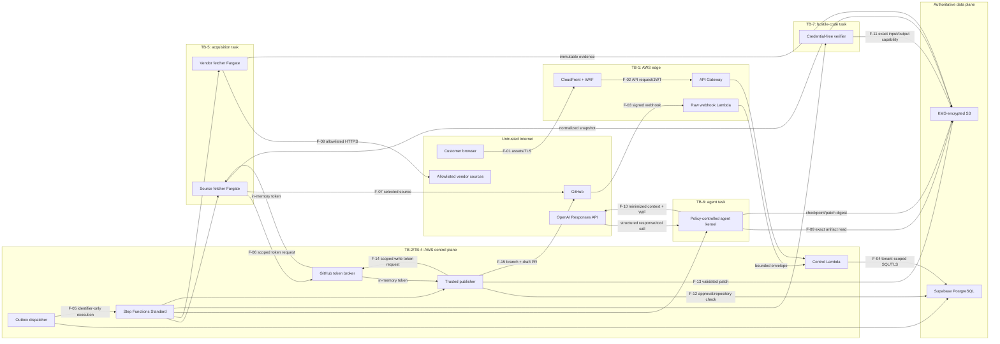
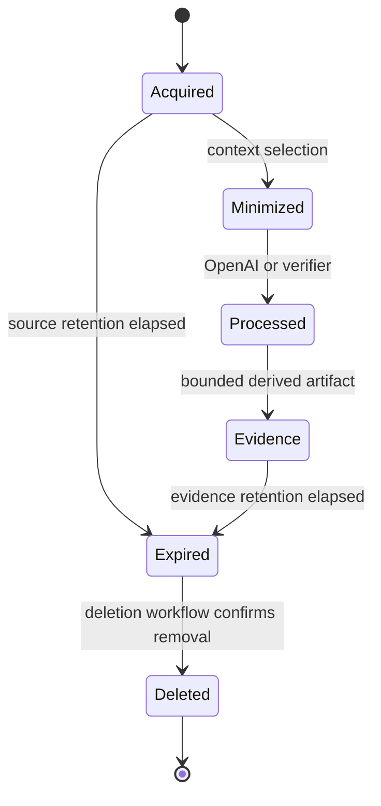

# Migration API security data flow

- **Status:** Stage 0 baseline
- **Version:** 1.0
- **Date:** 2026-07-24

## 1. System and trust boundaries

The diagram shows logical flows. It does not imply that API and webhook ingress
share an authorization mechanism or that execution tasks share a network.

## 2. Numbered flow contracts

| Flow | Data                                              | Classification      | Authentication/integrity                                | Persistence                          |
| ---- | ------------------------------------------------- | ------------------- | ------------------------------------------------------- | ------------------------------------ |
| F-01 | Hashed web assets                                 | Public              | CloudFront origin access and deployment manifest        | S3/CloudFront cache                  |
| F-02 | JWT, IDs, bounded JSON                            | Metadata/secret JWT | TLS; Supabase JWKS; issuer/audience/time; WAF limits    | Request metadata only                |
| F-03 | Raw GitHub webhook body and headers               | Metadata            | TLS; HMAC-SHA256 before parsing; delivery ID            | Bounded envelope/digest              |
| F-04 | Tenant-scoped SQL parameters                      | Customer metadata   | TLS; runtime DB role; parameter binding                 | PostgreSQL                           |
| F-05 | IDs, expected version, correlation ID             | Internal            | AWS IAM; event schema; deterministic execution name     | Step Functions history               |
| F-06 | Run, repo, operation                              | Authorization       | Caller IAM; broker database validation                  | Audit metadata                       |
| F-07 | One selected repository at exact commit           | Customer source     | Scoped installation token; GitHub TLS                   | Normalized KMS-encrypted S3 snapshot |
| F-08 | Allowlisted vendor response                       | Public/untrusted    | TLS; DNS/IP/redirect/size/content checks; source digest | Immutable KMS-encrypted evidence     |
| F-09 | Exact artifact ranges                             | Customer source     | Task-role prefix policy; digest check                   | Agent memory/workspace               |
| F-10 | Minimal excerpts, policy, tool schemas            | Customer source     | TLS; short-lived AWS-to-OpenAI WIF; controlled egress   | `store:false`; provider terms apply  |
| F-11 | Snapshot/patch input and verification result      | Customer-derived    | Exact short-lived S3 capabilities; digest/size schema   | Attempt-scoped S3 objects            |
| F-12 | Approval, membership, installation, current state | Authorization       | TLS; publisher runtime DB role; row/version predicates  | PostgreSQL                           |
| F-13 | Approved patch by key and digest                  | Customer-derived    | Exact S3 prefix; KMS; digest binding                    | Trusted publisher memory             |
| F-14 | Run, repo, publish operation                      | Authorization       | Publisher IAM; broker revalidation                      | Audit metadata                       |
| F-15 | Deterministic branch, commit, draft PR            | External mutation   | One-repository installation token; GitHub TLS           | GitHub and local provider IDs        |

## 3. Credential placement

| Credential                       | May exist in                                | Must not exist in                                    |
| -------------------------------- | ------------------------------------------- | ---------------------------------------------------- |
| Browser Supabase access token    | Browser session; API request                | Logs, S3, Step Functions, model context              |
| Supabase runtime password        | Secrets Manager; control Lambda memory      | Frontend, agent, verifier, workflow state            |
| Supabase migration password      | Secrets Manager; migration-task memory      | Runtime service, CI output, Terraform state          |
| GitHub App private key           | Secrets Manager; token-broker memory        | Source fetcher disk, publisher disk, agent, verifier |
| GitHub installation token        | Broker response and trusted caller memory   | PostgreSQL, S3, Step Functions, logs, browser        |
| AWS OIDC subject token           | Agent memory                                | Secrets Manager, checkpoints, logs, verifier         |
| OpenAI short-lived access token  | Official SDK/agent memory                   | AWS configuration, workflow state, logs, artifacts   |
| Exact S3 capability for verifier | Trusted bootstrap memory before/after tests | Child-process environment, test logs, model context  |

## 4. Prohibited flows

- Browser → core PostgreSQL mutation.
- Model → GitHub, PostgreSQL, Secrets Manager, arbitrary HTTP, or shell.
- Verifier test process → AWS metadata, GitHub, OpenAI, PostgreSQL, control
  plane, or general internet.
- GitHub token/private key → Step Functions, ECS overrides, S3, logs, or browser.
- Raw source/model prompt → CloudWatch, analytics, email, or metric dimensions.
- Vendor-provided URL → fetch without source-catalogue and SSRF validation.
- Agent patch → GitHub without independent deterministic validation.
- Publisher → merge or deployment API.

## 5. State ownership and recovery

| State                       | Authority                | Recovery rule                                                      |
| --------------------------- | ------------------------ | ------------------------------------------------------------------ |
| Membership and approval     | PostgreSQL               | Never reconstruct from JWT, workflow history, or GitHub comment    |
| Workflow progress           | Step Functions + run row | Reconcile terminal execution with expected run version             |
| Source/patch/evidence bytes | S3 plus recorded digest  | Object key alone is insufficient; verify digest and ownership      |
| Branch/pull-request state   | GitHub                   | Reconcile by repository numeric ID and deterministic branch        |
| Model reasoning             | Not authoritative        | Resume from structured checkpoint; do not persist hidden reasoning |
| Audit evidence              | Append-only DB/logs      | Redacted metadata; source remains in artifact plane                |

## 6. Data lifecycle

- Repository snapshots use the shortest practical retention.
- OpenAI processing follows the actual project data controls; `store:false` is
  mandatory but is not called zero retention.
- S3 lifecycle assists expiry but does not replace explicit tenant deletion.
- Organisation deletion blocks new work, cancels safe stages, deletes artifacts
  and application data, and records completion.

## 7. Required evidence before authority expansion

| Before stage | Required evidence                                                       |
| ------------ | ----------------------------------------------------------------------- |
| 1            | JWT denial tests; OpenAI WIF; egress denial; no-source logging          |
| 2            | Webhook signature/replay; token broker; selected-repo enforcement       |
| 3            | SSRF and vendor provenance corpus                                       |
| 5            | Prompt-injection and patch-policy fixtures                              |
| 6            | Hostile verifier containment suite                                      |
| 7            | Approval/base/digest revalidation and idempotent publication            |
| 8            | Customer-specific processing disclosure and retention configuration     |
| 9            | Cross-tenant review, deletion/restore, credential rotation, break-glass |

## 8. Change control

Any new data flow carrying source, credentials, external mutation, or untrusted
execution requires:

1. this diagram and flow table to be updated;
2. a threat-register entry and test;
3. IAM and egress review;
4. retention/deletion review;
5. an ADR when the trust boundary changes.
